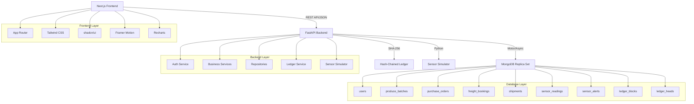

# AgriChain System Architecture

## High-Level Architecture



## Module Descriptions

### Authentication Module
- JWT-based authentication with access and refresh tokens
- bcrypt password hashing
- Role-based access control (6 roles)
- Token refresh and revocation

### Supply Chain Module
- Farm and produce catalogue management
- Harvest batch creation with unique IDs
- Quality inspection and grading
- Inventory management with FEFO allocation

### Freight Module
- Purchase orders (commercial)
- Freight bookings (logistics)
- Transporter quotations
- Vehicle and driver management
- Shipment execution

### Cold-Chain Module
- Backend sensor simulation
- Commodity-specific handling profiles
- Threshold-based alerts
- Alert acknowledgement and resolution

### Ledger Module
- SHA-256 hash-chained audit trail
- Transaction-safe appending
- Full chain integrity verification
- Entity-specific audit history

### Analytics Module
- Dashboard metrics from real database
- Shipment, fleet, freight, quality analytics
- Chart data via Recharts

## Data Flow

```
User Action → Frontend → API Endpoint → Service → Repository → MongoDB
                                                   ↓
                                           Ledger Service
                                                   ↓
                                           MongoDB (ledger_blocks)
```

## Security Architecture

- All secrets in environment variables
- JWT tokens stored in httpOnly cookies
- Role-based endpoint permissions
- Resource ownership checks
- CORS configuration
- Input validation with Pydantic