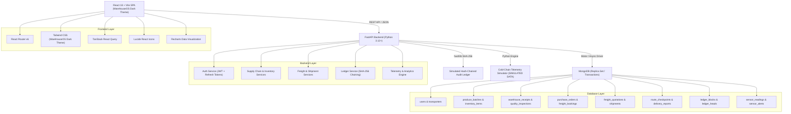

# AgriChain System Architecture

## High-Level Architecture

---

## 1. Role-Based Access Control (RBAC) Matrix

AgriChain strictly enforces operational boundaries across six discrete roles. No role may execute workflows outside its domain:

| Functional Area | Action | ADMIN | FARMER | WAREHOUSE_MGR | TRANSPORTER | DRIVER | BUYER |
| :--- | :--- | :---: | :---: | :---: | :---: | :---: | :---: |
| **Authentication** | Self-Registration | ❌ | ✅ (Auto) | ⏳ (Approval) | ⏳ (Approval) | ⏳ (Approval) | ✅ (Auto) |
| | User Approval / Suspension | ✅ | ❌ | ❌ | ❌ | ❌ | ❌ |
| **Agriculture** | Register Farm / Crop | ❌ | ✅ | ❌ | ❌ | ❌ | ❌ |
| | Create Produce Batch | ❌ | ✅ | ❌ | ❌ | ❌ | ❌ |
| **Warehouse** | Create Warehouse Receipt | ✅ | ❌ | ✅ | ❌ | ❌ | ❌ |
| | Log Quality Inspection | ✅ | ❌ | ✅ | ❌ | ❌ | ❌ |
| | Manage Inventory (FEFO) | ✅ | ❌ | ✅ | ❌ | ❌ | ❌ |
| **Commerce** | Create Purchase Order | ❌ | ❌ | ❌ | ❌ | ❌ | ✅ |
| | Accept / Reject Order | ❌ | ✅ | ❌ | ❌ | ❌ | ❌ |
| **Freight** | Create Freight Booking | ❌ | ✅ | ❌ | ❌ | ❌ | ✅ |
| | Submit Freight Quote | ❌ | ❌ | ❌ | ✅ | ❌ | ❌ |
| | Accept Freight Quote | ❌ | ✅ | ❌ | ❌ | ❌ | ✅ |
| **Shipments** | Create Shipment Consignment | ❌ | ❌ | ❌ | ✅ | ❌ | ❌ |
| | Load & Dispatch Shipment | ❌ | ❌ | ❌ | ✅ | ❌ | ❌ |
| | Log Corridor Checkpoint | ❌ | ❌ | ✅ | ✅ | ✅ | ❌ |
| **Delivery** | Submit Delivery Report | ❌ | ❌ | ❌ | ✅ | ✅ | ❌ |
| | Confirm / Reject Delivery | ❌ | ❌ | ❌ | ❌ | ❌ | ✅ |
| **Ledger & Audit** | Verify Full Hash Chain | ✅ | ❌ | ❌ | ❌ | ❌ | ❌ |
| | View Entity History | ✅ | ✅ | ✅ | ✅ | ✅ | ✅ |

---

## 2. Core Business Workflows

### A. Warehouse Intake & Exact Weight Reconciliation
When harvested produce arrives at a hub or aggregation warehouse:
- **Intake Formula**: `abs(received - (accepted + damaged + rejected)) <= 0.01 kg`.
- Every kilogram received must be explicitly reconciled against accepted, damaged, or rejected bins.
- Accepted produce updates active inventory with `status = AVAILABLE` and quality grades (`GRADE_A`, `GRADE_B`, `GRADE_C`, `REJECTED`).
- Quality inspections log visual quality, size uniformity, ripeness, defect percentage, and foreign matter checks.

### B. Purchase Orders & Freight Bookings
- A **Buyer** browses available produce and places a `PurchaseOrder` with preferred delivery dates and pickup terms.
- The **Farmer** accepts the purchase order, reserving the produce batch quantity.
- Once accepted, either Buyer or Farmer initiates a `FreightBooking` specifying packaging details, vehicle requirements, and corridor transit dates.

### C. Transporter Quotation & Shipment Execution
- Transporters review pending freight bookings and submit binding cost and transit-time quotations.
- The Buyer accepts a quotation, transitioning the freight booking to `CONFIRMED`.
- The Transporter allocates an available vehicle and driver, creating the `Shipment` consignment (`DRIVER_ASSIGNED`).
- The Transporter performs physical vehicle loading (`LOADED`) and dispatches the consignment (`DISPATCHED` / `IN_TRANSIT`).

### D. Corridor Tracking & Delivery Verification
- In place of battery-draining live GPS maps, drivers log progress at discrete corridor milestones and checkpoints.
- Upon arrival at destination, the driver submits a detailed `DeliveryReport` specifying delivered, damaged, and missing quantities along with photographic evidence.
- The consignee **Buyer** inspects the cargo and executes `confirm_delivery`, `partial_delivery`, or `reject_delivery`.

---

## 3. Simulated Hash-Chained Audit Ledger

- **Mechanism**: Pure Python `hashlib.sha256` hash chaining stored in MongoDB collections `ledger_blocks` and `ledger_heads`.
- **Genesis Block**: Root index `0` with `previous_hash = "0" * 64`.
- **Chain Integrity**: Each block cryptographically seals:
  $$\text{current\_hash} = \text{SHA-256}(\text{index} \parallel \text{previous\_hash} \parallel \text{timestamp} \parallel \text{event\_type} \parallel \text{entity\_type} \parallel \text{entity\_id} \parallel \text{actor\_id} \parallel \text{payload})$$
- **Verification Endpoint**: `GET /api/v1/ledger/verify` validates the entire hash chain from genesis to head, pinpointing any modified or inserted records immediately.
- **Clarification**: Pure simulated tamper-evident log in MongoDB. No Solidity, smart contracts, or Web3 network required.

---

## 4. Cold-Chain Environmental Simulation

- **Simulation Only**: All telemetry readings (temperature, humidity, sensor alerts) are generated by a deterministic Python backend engine and clearly labeled **`SIMULATED DATA`** across the interface.
- **Profiles**: Commodity-specific thresholds (e.g., Tomato: 10°C–15°C, Banana: 13°C–14°C, Apple: 0°C–4°C).
- **Scenarios**: Normal cold chain, temperature excursion, humidity excursion, fluctuation, and recovery.
